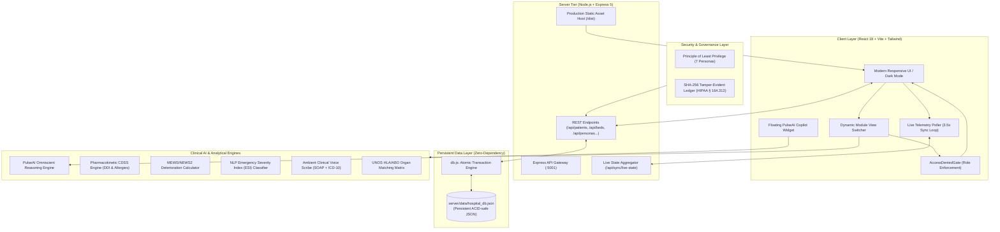

# 🏥 PulseCare OS 2.0 — Enterprise Full-Stack Hospital Operating System & Clinical AI Platform

<div align="center">

[](https://react.dev/)
[](https://www.typescriptlang.org/)
[](https://nodejs.org/)
[](https://vitejs.dev/)
[](https://tailwindcss.com/)
[](https://www.hhs.gov/hipaa/index.html)
[](LICENSE)

**An industrial, production-ready Full-Stack Hospital Management System (HMS) combining 10 Core Healthcare Administrative Workflows with 11 Cutting-Edge Clinical AI Decision Engines, persistent zero-dependency database storage, real-time patient telemetry syncing, and HIPAA-compliant cryptographic security.**

[Live Architecture](#-system-architecture) • [Core Features](#-10-core-hospital-management-workflows) • [AI Modules](#-11-cutting-edge-clinical-ai--critical-care-modules) • [Security & RBAC](#-role-based-access-control-rbac--privacy-gates) • [Deployment Guide](#-step-by-step-deployment-guide)

</div>

---

## 🌟 Executive Overview

**PulseCare OS 2.0** is an enterprise-grade digital health platform architected for modern healthcare systems, private hospitals, and emergency trauma centers. It bridges traditional hospital administration (EHR, billing, bed management, pharmacy inventory, OPD tokens) with modern predictive clinical artificial intelligence (Pharmacokinetic CDSS, MEWS/NEWS2 Sepsis Early Warning, NLP Emergency Triage, Ambient Clinical Voice Scribing, and UNOS-compliant Organ Matching).

### 💎 Key Full-Stack Capabilities
- **🚀 Unified Full-Stack Architecture**: Single-command startup (`npm run dev`) concurrently boots the Express API backend (`http://localhost:5001`) and the Vite React frontend (`http://localhost:3000`).
- **💾 Durable In-Repository Database**: Transactional file-backed JSON database engine (`server/data/hospital_db.json`) using atomic temporary file renames. Guarantees 100% data persistence across restarts, power outages, or months of dormancy without requiring PostgreSQL, MySQL, or Docker installations.
- **🤖 PulseAI Omniscient Copilot & Chatbot**: Cross-system clinical intelligence assistant with full real-time access to all registered patients, vitals, ICU beds, pharmacy formularies, blood bank reserves, and doctor rosters. Features proactive clinical notification suggestions, action dispatch shortcuts, and Text-to-Speech audio dictation.
- **🛡️ Strict Role-Based Privacy Gates (RBAC)**: Enforces the Principle of Least Privilege (PoLP). Patients are securely locked out of clinical dashboards (Prescriptions, CDSS, Audit Ledger, Emergency Dispatcher) with an interactive 403 Forbidden gate.
- **👥 Dynamic Persona Lifecycle Management**: Administrators can create custom clinical personas, assign credentials and permissions, delete obsolete roles, and switch identities on the fly.
- **✏️ Universal Master Administrative Editing**: Super Admins possess granular editing access across all patient EHR records, ICU bed allocations, doctor fees, medication inventories, and billing invoices.
- **📡 Continuous Live Sync (3.5s Telemetry)**: Real-time background sync engine that simulates ICU patient vital sign jitter (heart rate, SpO2) and broadcasts emergency codes instantaneously without manual browser reloads.

---

## 🏗️ System Architecture



---

## 📋 Comprehensive Feature Matrix

### 🏥 10 Core Hospital Management Workflows

| # | Core Feature | File Path | Clinical & Administrative Capabilities |
|:---:|---|---|---|
| **1** | **Patient EHR & Longitudinal Timeline** | [`PatientRegistry.tsx`](file:///Users/omkumar/Desktop/MDM/src/components/core/PatientRegistry.tsx) | Complete Unique Hospital Identification (UHID), demographic registry, documented allergies, chronic conditions, real-time vitals history, administrative record editing modal, and chronological clinical encounter timelines. |
| **2** | **Doctor Directory & Specialist Roster** | [`DoctorDirectory.tsx`](file:///Users/omkumar/Desktop/MDM/src/components/core/DoctorDirectory.tsx) | Multi-department specialist catalog (Cardiology, Trauma ER, Nephrology, Surgery), credential verification, on-duty toggles, shift schedules, ratings, and consultation fees. |
| **3** | **OPD Appointments & Token Queue** | [`AppointmentScheduler.tsx`](file:///Users/omkumar/Desktop/MDM/src/components/core/AppointmentScheduler.tsx) | Automated OPD token generation, department-wise booking, doctor slot reservation, live token queue visualizer, and status tracking (`Scheduled`, `In-Progress`, `Completed`, `Cancelled`). |
| **4** | **Bed Fleet & Ward Capacity Manager** | [`BedWardManager.tsx`](file:///Users/omkumar/Desktop/MDM/src/components/core/BedWardManager.tsx) | Visual bed grid across ICU, CCU, Emergency, General Wards A/B, and Pediatric suites with piped oxygen support and mechanical ventilator capability indicators. Supports instant patient bed assignment, transfer, and discharge sanitization. |
| **5** | **Pharmacy Inventory & Formulary** | [`PharmacyInventory.tsx`](file:///Users/omkumar/Desktop/MDM/src/components/core/PharmacyInventory.tsx) | Pharmaceutical catalog with batch numbers, expiration countdowns, automated critical low-stock reorder thresholds, contraindication warnings, and 1-click outpatient dispensation logging. |
| **6** | **Laboratory & Diagnostic Hub** | [`LaboratoryHub.tsx`](file:///Users/omkumar/Desktop/MDM/src/components/core/LaboratoryHub.tsx) | Pathology, radiology, biochemistry, and microbiology order tracking. Features panic/abnormal value flags, normal reference range validation, and certified digital report generation. |
| **7** | **Medical Billing, Invoicing & Insurance (TPA)** | [`BillingInvoicePortal.tsx`](file:///Users/omkumar/Desktop/MDM/src/components/core/BillingInvoicePortal.tsx) | Itemized medical invoices covering room charges, doctor rounds, lab assays, and medications. Features Third-Party Administrator (TPA) insurance pre-authorization, patient co-pay calculator, and printable invoices. |
| **8** | **Emergency ER Rapid Intake Desk** | [`EmergencyIntakeDesk.tsx`](file:///Users/omkumar/Desktop/MDM/src/components/core/EmergencyIntakeDesk.tsx) | Zero-delay emergency intake desk with ambulance docking log, trauma bay assignments, severity tagging (`Red`, `Orange`, `Yellow`, `Green`), and rapid stabilization status tracking. |
| **9** | **Role-Based Access Control (RBAC) Matrix** | [`RolePortalDashboard.tsx`](file:///Users/omkumar/Desktop/MDM/src/components/core/RolePortalDashboard.tsx) | Granular permission matrix for **7 Healthcare Personas**: Super Admin, Attending Doctor, Head Nurse, Pharmacist, Lab Technician, Receptionist, and Patient. |
| **10** | **Digital Prescription Pad (E-Rx)** | [`DigitalPrescriptionPad.tsx`](file:///Users/omkumar/Desktop/MDM/src/components/core/DigitalPrescriptionPad.tsx) | Physician electronic prescription pad with multi-frequency timing (`1-0-1`, `SOS`, `STAT`), food timing rules, treatment duration, and cryptographically verified digital signatures. |

---

### 🚀 11 Cutting-Edge Clinical AI & Critical Care Modules

| # | Advanced AI Feature | File Path | Technical Implementation & Clinical Value |
|:---:|---|---|---|
| **1** | **PulseAI Omniscient Copilot & Chatbot** | [`AICopilotView.tsx`](file:///Users/omkumar/Desktop/MDM/src/components/advanced/AICopilotView.tsx) | **Omniscient hospital AI assistant** indexed across all active EHR records, bed allocations, formulary stocks, and blood reserves. Computes **proactive real-time clinical notification suggestions**, answers natural language queries with live metrics, provides 1-click clinical dispatch shortcuts, and includes Text-to-Speech audio dictation alongside a persistent floating widget. |
| **2** | **AI CDSS & Drug Interaction Checker** | [`CDSSDrugInteractionChecker.tsx`](file:///Users/omkumar/Desktop/MDM/src/components/advanced/CDSSDrugInteractionChecker.tsx) | Real-time pharmacokinetic & pharmacodynamic interaction analyzer. Evaluates prospective prescriptions against concurrent medications and patient allergies, classifying interactions by severity (`Critical`, `Major`, `Moderate`) with physiological mechanisms and clinical advice. |
| **3** | **Modified Early Warning Score (MEWS / NEWS2)** | [`EarlyWarningScoreCalculator.tsx`](file:///Users/omkumar/Desktop/MDM/src/components/advanced/EarlyWarningScoreCalculator.tsx) | Predictive deterioration scoring computed from live vital signs (Heart rate, Systolic BP, Respiratory rate, SpO2, Temperature, AVPU consciousness). Identifies impending septic shock, respiratory failure, or cardiac arrest hours prior to clinical collapse. |
| **4** | **Smart AI Emergency Triage Assistant** | [`SmartAITriageAssistant.tsx`](file:///Users/omkumar/Desktop/MDM/src/components/advanced/SmartAITriageAssistant.tsx) | NLP-assisted intake classifier that processes natural language chief complaints and vital telemetry, mapping patients into the **Emergency Severity Index (ESI Levels 1-5)** with red-flag detection and STAT diagnostic recommendations. |
| **5** | **Interactive 2D Spatial Ward Floor Plan** | [`FloorPlanVisualizer.tsx`](file:///Users/omkumar/Desktop/MDM/src/components/advanced/FloorPlanVisualizer.tsx) | Multi-level architectural blueprint view (Ground Floor ER, 1st Floor Wards, 2nd Floor ICU) with real-time color-coded room status pulses, life-support connections, and direct tap-to-manage room modals. |
| **6** | **Smart Blood Bank & Plasma Network** | [`BloodBankMatrix.tsx`](file:///Users/omkumar/Desktop/MDM/src/components/advanced/BloodBankMatrix.tsx) | Inventory management for all 8 ABO/Rh blood groups, real-time cold-chain temperature telemetry (2.0°C - 6.0°C), transfusion cross-match compatibility matrix, and 1-click emergency regional donor SOS broadcasts. |
| **7** | **Ambient AI Clinical Scribe** | [`AmbientVoiceScribe.tsx`](file:///Users/omkumar/Desktop/MDM/src/components/advanced/AmbientVoiceScribe.tsx) | Speech-to-text dictation simulator that parses natural physician-patient dialogue and automatically formats it into structured **SOAP Notes** (Subjective, Objective, Assessment, Plan) with auto-suggested **ICD-10 diagnostic billing codes**. |
| **8** | **Cryptographic PHI Access Audit Ledger** | [`CryptographicAuditLedger.tsx`](file:///Users/omkumar/Desktop/MDM/src/components/advanced/CryptographicAuditLedger.tsx) | Immutable, blockchain-inspired SHA-256 block hash chaining satisfying **HIPAA § 164.312(b)**. Features a live mathematical verification engine that detects tampering or unauthorized alteration in any block. |
| **9** | **Emergency Code Blue & Disaster Dispatcher** | [`EmergencyCodeDispatcher.tsx`](file:///Users/omkumar/Desktop/MDM/src/components/advanced/EmergencyCodeDispatcher.tsx) | Hospital-wide broadcast command center for **Code Blue** (Cardiac Arrest), **Code Red** (Fire), **Code Black** (Threat), **Code Pink** (Infant), and **Mass Casualty Incidents (MCI)** with real-time crash team paging acknowledgements. |
| **10** | **Organ Transplant Match Registry** | [`OrganTransplantRegistry.tsx`](file:///Users/omkumar/Desktop/MDM/src/components/advanced/OrganTransplantRegistry.tsx) | UNOS/OPTN-standard transplant allocation algorithm computing compatibility scores based on ABO blood group matching, **HLA antigen overlap**, Medical Urgency tiers (Status 1A/1B), and **Cold Ischemia Time (CIT)** viability timers. |
| **11** | **Telemedicine Virtual Consultation Suite** | [`TelemedicineSuite.tsx`](file:///Users/omkumar/Desktop/MDM/src/components/advanced/TelemedicineSuite.tsx) | Encrypted virtual examination room with simulated WebRTC peer feeds, live biometric vital signs telemetry overlay, shared educational whiteboard, in-call messaging, and seamless electronic prescription handoff. |

---

## 🛡️ Role-Based Access Control (RBAC) & Privacy Gates

PulseCare OS 2.0 enforces a multi-tiered security model aligned with the **Principle of Least Privilege (PoLP)** and **HIPAA Security Rule § 164.308(a)(1)**:

```
┌─────────────────────────┬────────┬────────┬───────┬────────────┬──────────┬──────────────┬─────────┐
│ Module / Action         │ Admin  │ Doctor │ Nurse │ Pharmacist │ Lab Tech │ Receptionist │ Patient │
├─────────────────────────┼────────┼────────┼───────┼────────────┼──────────┼──────────────┼─────────┤
│ Patient Self-Portal     │   ✅   │   ✅   │  ✅   │     ✅     │    ✅    │      ✅      │   ✅    │
│ Book Appointments       │   ✅   │   ✅   │  ✅   │     ❌     │    ❌    │      ✅      │   ✅    │
│ View Clinical EHR       │   ✅   │   ✅   │  ✅   │     ❌     │    ❌    │      ❌      │   ❌    │
│ Edit Patient Records    │   ✅   │   ✅   │  ❌   │     ❌     │    ❌    │      ❌      │   ❌    │
│ Issue Prescriptions     │   ✅   │   ✅   │  ❌   │     ❌     │    ❌    │      ❌      │   ❌    │
│ CDSS Interaction Check  │   ✅   │   ✅   │  ❌   │     ✅     │    ❌    │      ❌      │   ❌    │
│ MEWS Deterioration Calc │   ✅   │   ✅   │  ✅   │     ❌     │    ❌    │      ❌      │   ❌    │
│ Dispense Medications    │   ✅   │   ❌   │  ❌   │     ✅     │    ❌    │      ❌      │   ❌    │
│ Verify Lab Orders       │   ✅   │   ✅   │  ❌   │     ❌     │    ✅    │      ❌      │   ❌    │
│ Bed Fleet Allocation    │   ✅   │   ✅   │  ✅   │     ❌     │    ❌    │      ❌      │   ❌    │
│ Emergency Code Blue     │   ✅   │   ✅   │  ✅   │     ❌     │    ❌    │      ❌      │   ❌    │
│ SHA-256 Audit Ledger    │   ✅   │   ❌   │  ❌   │     ❌     │    ❌    │      ❌      │   ❌    │
│ Persona Management      │   ✅   │   ❌   │  ❌   │     ❌     │    ❌    │      ❌      │   ❌    │
└─────────────────────────┴────────┴────────┴───────┴────────────┴──────────┴──────────────┴─────────┘
```

> **Security Gate Guarantee**: If an unauthorized persona (such as a Patient) attempts to access restricted clinical tools like Prescriptions or the Cryptographic Audit Ledger, the system displays an animated **403 Forbidden Access Gate** with an explanation of the required credentials.

---

## 💾 Zero-Dependency In-Repository Database

Traditional hospital management systems require setting up complex external databases (PostgreSQL, MySQL, Redis, or Docker containers). PulseCare OS 2.0 uses a self-contained, ACID-safe, file-backed transactional database engine:

- **Location**: [`server/data/hospital_db.json`](file:///Users/omkumar/Desktop/MDM/server/data/hospital_db.json)
- **Atomic Disk Writes**: Writes are completed via temporary atomic file renames (`fs.writeFileSync(tempPath)` ➔ `fs.renameSync(tempPath, realPath)`), eliminating file corruption during sudden power losses.
- **Persistence Across Months**: Any edits made to patient demographics, bed assignments, doctor fees, custom staff personas, or prescriptions remain permanently intact across reboots, browser reloads, or months of server dormancy.

---

## 🚀 Step-by-Step Deployment Guide

### Part 1: Push to GitHub

You already have the repository created on GitHub under **`omkumar-rajput/PulseCare`**. Follow these exact steps in your Mac terminal:

```bash
# 1. Navigate to your project directory
cd /Users/omkumar/Desktop/MDM

# 2. Link your local project to your GitHub repository
git remote add origin https://github.com/omkumar-rajput/PulseCare.git

# 3. Ensure the branch is named main
git branch -M main

# 4. Push all commits to your GitHub repository
git push -u origin main
```

*(If Git asks for your credentials, enter your GitHub username `omkumar-rajput` and your **Personal Access Token** as your password).*

---

### Part 2: Deploy Publicly on Render (Free, 2 Minutes)

Render allows you to host this full-stack application online with a permanent public URL at zero cost:

1. **Sign Up / Log In**:
   - Go to **[https://render.com](https://render.com)** and click **"Get Started"** or **"Sign In"** using your GitHub account (`omkumar-rajput`).

2. **Create New Web Service**:
   - In the Render Dashboard, click the blue **"New +"** button in the top right.
   - Select **"Web Service"**.

3. **Connect Your GitHub Repository**:
   - Under *Connect a repository*, find and click **"Connect"** on **`omkumar-rajput/PulseCare`**.

4. **Configure Service Settings**:
   - **Name**: `pulsecare` (or `pulsecare-hms`)
   - **Region**: Choose the closest location (e.g., `Singapore` or `Frankfurt`)
   - **Branch**: `main`
   - **Runtime**: `Node`
   - **Build Command**: 
     ```bash
     npm install && npm run build
     ```
   - **Start Command**: 
     ```bash
     npm start
     ```
   - **Instance Type**: Select **Free** ($0 / month)

5. **Deploy**:
   - Click the **"Deploy Web Service"** button at the bottom.
   - Render will automatically install dependencies, build the TypeScript/Vite frontend into `dist/`, and start the persistent Express API server.
   - Within 90–120 seconds, you will receive a live URL:
     ```
     https://pulsecare.onrender.com
     ```
   - You can now open this link on your phone, tablet, or share it with hospital administrators and clinicians!

---

## 💻 Local Development Setup

If you want to run or test the project locally on another machine:

```bash
# 1. Clone the repository
git clone https://github.com/omkumar-rajput/PulseCare.git

# 2. Enter directory
cd PulseCare

# 3. Install dependencies
npm install

# 4. Start Full-Stack Dev Server (Runs Express API on 5001 & Vite on 3000)
npm run dev
```

- **Frontend Application**: `http://localhost:3000`
- **Backend API**: `http://localhost:5001/api`
- **Telemetry Live Sync**: `http://localhost:5001/api/sync/live-state`

---

## 📂 Project Directory Structure

```text
MDM/
├── dist/                              # Production compiled bundle
├── server/                            # Persistent Backend API Engine
│   ├── data/
│   │   └── hospital_db.json           # ACID-safe persistent hospital database
│   ├── db.js                          # Transactional database manager & seed data
│   └── index.js                       # Express 5 REST API & Telemetry Jitter Engine
├── src/
│   ├── components/
│   │   ├── advanced/                  # 11 Cutting-Edge Clinical AI Modules
│   │   │   ├── AICopilotView.tsx      # PulseAI Omniscient Assistant & Chatbot
│   │   │   ├── AmbientVoiceScribe.tsx # Speech-to-SOAP note & ICD-10 engine
│   │   │   ├── BloodBankMatrix.tsx    # 8-group cold-chain & transfusion matrix
│   │   │   ├── CDSSDrugInteractionChecker.tsx # Pharmacokinetic DDI & allergy scanner
│   │   │   ├── CryptographicAuditLedger.tsx   # SHA-256 HIPAA compliance ledger
│   │   │   ├── EarlyWarningScoreCalculator.tsx# MEWS / NEWS2 deterioration scorer
│   │   │   ├── EmergencyCodeDispatcher.tsx    # Code Blue / Red crash team dispatcher
│   │   │   ├── FloorPlanVisualizer.tsx        # Spatial 2D ward & room manager
│   │   │   ├── OrganTransplantRegistry.tsx    # UNOS HLA/ABO organ allocation
│   │   │   ├── SmartAITriageAssistant.tsx     # NLP ESI Level 1-5 triage classifier
│   │   │   └── TelemedicineSuite.tsx          # WebRTC virtual exam suite
│   │   ├── common/                    # Shared Infrastructure Components
│   │   │   ├── AccessDeniedGate.tsx   # 403 Forbidden RBAC gatekeeper
│   │   │   ├── FloatingAICopilot.tsx  # Persistent docked floating AI assistant
│   │   │   ├── Navbar.tsx             # Global navigation & live sync badge
│   │   │   ├── NotificationToast.tsx  # Clinical alert toast broadcaster
│   │   │   ├── PersonaManagementModal.tsx # Add/edit/delete staff personas
│   │   │   ├── RoleSwitcherModal.tsx  # Instant persona identity switcher
│   │   │   └── Sidebar.tsx            # Navigation rail (24 distinct views)
│   │   ├── core/                      # 10 Core Hospital Administration Workflows
│   │   │   ├── AppointmentScheduler.tsx # OPD slot booking & token visualizer
│   │   │   ├── BedWardManager.tsx     # ICU / ward fleet capacity & oxygen allocation
│   │   │   ├── BillingInvoicePortal.tsx # TPA insurance claims & billing
│   │   │   ├── DigitalPrescriptionPad.tsx # E-Prescription generator & signature
│   │   │   ├── DoctorDirectory.tsx    # Specialist rosters & shift schedules
│   │   │   ├── EmergencyIntakeDesk.tsx# ER triage bay docking & intake
│   │   │   ├── LaboratoryHub.tsx      # Pathology & diagnostic assay tracker
│   │   │   ├── PatientRegistry.tsx    # Longitudinal EHR & demographic registry
│   │   │   ├── PharmacyInventory.tsx  # Pharmaceutical formulary & dispensation
│   │   │   └── RolePortalDashboard.tsx# Multi-role permission matrix
│   │   └── dashboards/                # High-Level Visual Dashboards
│   │       ├── AnalyticsDashboard.tsx # Operational throughput & clinical KPIs
│   │       ├── OverviewDashboard.tsx  # Executive hospital command center
│   │       └── PatientSelfServicePortal.tsx # Patient self-service portal
│   ├── context/
│   │   └── HospitalContext.tsx        # Central React state & auto-sync manager
│   ├── types/
│   │   └── index.ts                   # Strict TypeScript domain interfaces
│   ├── utils/                         # Clinical Algorithms & Calculators
│   │   ├── aiCopilotEngine.ts         # Cross-system knowledge parser & suggestions
│   │   ├── cdssEngine.ts              # Pharmacological interaction rules
│   │   ├── cryptoAudit.ts             # SHA-256 cryptographic hashing engine
│   │   ├── mewsCalculator.ts          # MEWS physiological scoring engine
│   │   ├── organMatching.ts           # UNOS donor-recipient algorithm
│   │   └── triageClassifier.ts        # NLP Emergency Severity Index classifier
│   ├── App.tsx                        # Root layout & route protection
│   └── main.tsx                       # React application entry point
├── package.json                       # Dependencies & scripts
├── tsconfig.json                      # Strict TypeScript compiler configuration
└── vite.config.ts                     # Vite build configuration with API reverse proxy
```

---

## 👨‍💻 Author

**Omkumar Rajput**
- **GitHub**: [@omkumar-rajput](https://github.com/omkumar-rajput)
- **Institution**: MIT Academy of Engineering, Pune, India
- **Email**: omkumarr85@gmail.com

---

## 📄 License

This project is licensed under the **MIT License** — feel free to use it for personal, commercial, or academic deployments.
